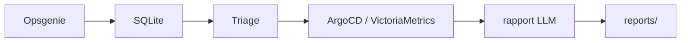

# alert-sleuth : Assistant AIOps en lecture seule

Statut : v1 expérimentale. Pipeline complet (ingestion, triage, collecte, analyse LLM, rapports, UI web) fonctionnel en mode démo ; pas encore éprouvé sur des sources réelles. L'agent d'investigation (boucle d'outils) n'est pas encore implémenté.

`alert-sleuth` est un assistant AIOps en lecture seule pour une équipe SRE. Il réduit la fatigue d'alerte et accélère l'investigation manuelle en transformant les alertes brutes en rapports d'incident classés et étayés par des preuves. Il ingère les alertes, les regroupe et les évalue, collecte des preuves corrélées et produit des rapports structurés qui citent les preuves utilisées.



## Démarrage rapide

Prérequis : [uv](https://docs.astral.sh/uv/), [just](https://just.systems/), un endpoint LLM compatible OpenAI (par défaut `http://127.0.0.1:8000/v1`).

```bash
just install      # uv sync
just dev          # instance de dev sur données de démo : http://127.0.0.1:8080
just test         # tests
just              # liste des recettes
```

Configuration : `cp .env.example .env` puis remplir. Le fichier `.env` (ignoré par git) est chargé au démarrage ; une valeur vide signifie « valeur par défaut », et les vraies variables d'environnement l'emportent.

Mise en service progressive sur l'infra réelle :

1. **Alertes seules** : renseigner `OPSGENIE_API_KEY` (clé avec le seul droit `Read`), laisser `AIOPS_SOURCES` vide, puis `just fetch`, `just triage`, `just list`, `just web`.
2. **VictoriaMetrics et Elasticsearch via les MCP de LiteLLM** : renseigner `LITELLM_MCP_URL` et `LITELLM_API_KEY`, lancer `just mcp-tools` pour lire les noms exacts des outils (LiteLLM les préfixe par l'alias du serveur), les reporter dans `VM_MCP_TOOL` et `ES_MCP_TOOL`, puis `AIOPS_SOURCES=victoriametrics,elasticsearch` et tester la collecte sans LLM avec `just collect <groupe>`.
3. **ArgoCD et Azure CLI** (plus tard) : ajouter `argocd,azure` à `AIOPS_SOURCES`, avec un compte ArgoCD en lecture seule et une session `az login` au rôle `Reader`.

Une source non listée dans `AIOPS_SOURCES` n'est pas interrogée et n'est pas comptée comme preuve manquante.

## Phases

| Phase | Entrée | Sortie | Statut |
|---|---|---|---|
| Ingestion | alertes Opsgenie | alertes SQLite avec état de cycle de vie et dedupe d'alias | planifié |
| Triage | liste d'alertes | alertes groupées et scores d'attention explicables | planifié |
| Enrichissement | une alerte et le mapping de service | instantané de preuves à partir des journaux, métriques, déploiements et changements de configuration | planifié |
| Analyse | alerte et preuves condensées | rapport d'incident JSON structuré et Markdown rendu | planifié |
| Persistance | rapport, preuves, feedback | artefacts stockés et données étiquetées pour un travail futur sur les modèles | planifié |

## Principes directeurs

- La lecture seule est imposée par les identifiants, pas seulement par le code : Azure Reader, rôle en lecture seule ArgoCD, utilisateurs en lecture seule Elasticsearch et VictoriaMetrics.
- Les preuves avant l'éloquence : chaque affirmation dans un rapport doit citer un identifiant d'élément de preuve.
- Déterministe avant ML : le groupement, le scoring, l'agrégation et le clustering de motifs s'exécutent avant toute étape LLM.
- Une alerte analysée de bout en bout avant tout travail d'interface.
- Explicabilité d'abord : pas de triage boîte noire au démarrage à froid ; règles pondérées et preuves enregistrées.
- Stockage local d'abord : SQLite pour les alertes, rapports, instantanés de preuves et feedback.

## CLI

```text
aiops fetch
aiops list
aiops triage
aiops analyze <id>
aiops report <id>
```

`fetch` interroge Opsgenie et stocke les alertes. `list` affiche les alertes stockées. `triage` groupe et classe les alertes. `analyze <id>` exécute les collecteurs et produit un rapport structuré. `report <id>` affiche ou imprime le rapport stocké.

## Périmètre v1 et feuille de route

### v1

- Ingestion Opsgenie dans SQLite avec cycle de vie open/acked/closed/reopened.
- Dedupe sur l'alias Opsgenie.
- Catalogue de services dans `catalog/services.yaml`.
- Collecteurs en lecture seule ArgoCD : santé des applications et historique de synchronisation.
- Collecteurs en lecture seule VictoriaMetrics : métriques autour de la fenêtre d'alerte.
- Une alerte analysée de bout en bout sur la CLI.
- Rapport JSON plus Markdown rendu.
- Instantané de preuves brut stocké avec le rapport.

### v2

- Collecteurs de journaux Elasticsearch.
- Clustering de motifs de journaux Drain3.
- Collecteurs en lecture seule Azure CLI : santé des ressources et Activity Log.
- Scoring de triage avec sévérité, criticité de service, récurrence et changements récents.
- Capture de feedback : utile, faux, la cause racine était X.
- Masquage des secrets, des IP et des jetons avant les appels LLM cloud.
- Chemin LLM local optionnel.

### v3

- Interface web (FastAPI + Jinja + htmx, sans intelligence) pour la liste d'alertes, le triage, le rapport et le feedback : voir [docs/ui.md](docs/ui.md).
- Clustering d'alertes et groupement d'incidents.
- Comparaison de rapports entre prompts et modèles.
- Jeu de données de feedback étiqueté.
- Triage ML ou clustering optionnel une fois que les données étiquetées le justifient.

## Arborescence du dépôt

```text
aiops/
  __init__.py
  cli.py
  ingest/
  triage/
  collectors/
  analysis/
  storage/
  web/                 # couche UI : routes FastAPI + templates Jinja
catalog/
  services.yaml
reports/
skills/                # prompts LLM (SKILL.md) par étape
tests/
  fixtures/
docs/
  workflows.md
  data-recommendations.md
  ui.md
  mockup/index.html
```

## Documentation

- [Flux de travail](docs/workflows.md)
- [Recommandations de données](docs/data-recommendations.md)
- [Interface web](docs/ui.md) et sa [maquette](docs/mockup/index.html)
