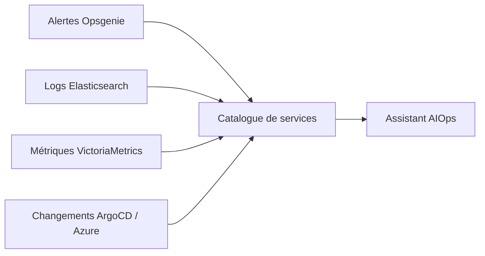

# Recommandations de données pour les entrées AIOps

Ce document indique aux équipes qui produisent des alertes, des logs, des métriques et des événements de changement comment rendre ces données exploitables par l'assistant AIOps en lecture seule. L'assistant ne devine pas le contexte manquant. Il corrèle les preuves à l'aide d'identifiants stables, d'horodatages, d'étiquettes et d'un catalogue de services.



## Alertes (Opsgenie)

### Pourquoi c'est important

Les alertes Opsgenie sont le point d'entrée. L'assistant utilise les alertes pour décider quoi investiguer, le dedupe des signaux répétés, associer l'alerte à un service et collecter des preuves. Si les alertes sont bruyantes, ambiguës ou manquent d'étiquettes, l'assistant ne peut pas trier, enrichir ou expliquer les incidents de manière fiable.

### Recommandations classées par impact

1. **Étiquettes obligatoires sur chaque alerte**
   - Étiquettes requises : `service`, `env`, `team`, `component`.
   - Les valeurs doivent correspondre à `catalog/services.yaml`.
   - Exemple : `service:checkout`, `env:prod`, `team:payments`, `component:payment-api`.

2. **Alias stable pour le dedupe**
   - L'alias doit identifier la condition d'alerte, pas l'occurrence.
   - Ne pas inclure d'horodatages, d'UUID, de noms d'hôtes, de noms de pods ou d'identifiants de requête dans l'alias.
   - Forme préférée : `<service>-<component>-<condition>`.
   - Exemple : `checkout-payment-timeout`.

3. **Hygiène de sévérité/priorité**
   - `P1` : un humain doit agir maintenant ; impact client, perte de revenus, perte de données ou violation d'un SLO principal.
   - `P2` : service dégradé avec un contournement ; agir dans les heures.
   - `P3`-`P5` : informationnel ou maintenance ; aucune action immédiate requise (ou aucune alerte du tout, un dashboard peut suffire).
   - Ne pas utiliser `P1` pour des avertissements censés se résoudre d'eux-mêmes.

4. **Chaque alerte doit être actionnable**
   - Inclure une URL de runbook.
   - Inclure une équipe propriétaire.
   - Si aucune action n'est possible, l'alerte doit être désactivée, rétrogradée ou convertie en métrique.

5. **La description doit inclure la condition de déclenchement**
   - Inclure la requête, le seuil et la fenêtre de temps qui ont déclenché l'alerte.
   - Inclure un lien vers le dashboard pertinent.
   - Inclure les ressources affectées si connues.

6. **Élaguer régulièrement les alertes bruyantes**
   - Produire un rapport hebdomadaire des alertes top-flapping.
   - Désactiver ou ajuster les alertes qui s'ouvrent/ferment plus de 5 fois en 24 heures sans action claire.
   - Ajouter de l'hystérésis, des fenêtres de dedupe ou des alertes basées sur les SLO si approprié.

### Mauvais vs bon exemple

Mauvais :

```json
{
  "alias": "alert-123456",
  "message": "CPU élevé",
  "priority": "P1",
  "description": "Le CPU est élevé sur un serveur",
  "tags": []
}
```

Bon :

```json
{
  "alias": "checkout-payment-timeout",
  "message": "Taux de timeout de paiement du checkout au-dessus du SLO",
  "priority": "P2",
  "description": "PromQL: rate(http_requests_total{service=\"checkout\", handler=\"payment\", status=~\"5..\"}[5m]) > 0.02. Dashboard: https://grafana.example.com/d/checkout. Runbook: https://runbooks.example.com/checkout/payment-timeout.",
  "tags": [
    "service:checkout",
    "env:prod",
    "team:payments",
    "component:payment-api"
  ]
}
```

### Comment mesurer la conformité

L'assistant calcule ces indicateurs à partir des alertes Opsgenie récupérées :

- Pourcentage d'alertes avec toutes les étiquettes obligatoires.
- Pourcentage d'alertes dont l'alias correspond à un motif stable et ne contient ni horodatage ni UUID.
- Pourcentage d'alertes `P1` et `P2` avec une URL de runbook et une équipe propriétaire.
- Nombre d'alertes flapping : alertes avec plus de 5 transitions ouverture/fermeture en 24 heures.
- Nombre d'alertes sans entrée correspondante dans le catalogue de services.

Les équipes doivent également linter les règles d'alerte en CI lorsque les définitions d'alerte sont dans un dépôt.

## Logs (Elasticsearch)

### Pourquoi c'est important

Les logs sont la preuve principale de « ce qui s'est passé ». L'assistant utilise les logs pour construire des chronologies, regrouper les erreurs répétées avec Drain3 et corréler les pannes aux services, versions, pods et requêtes. Les logs non structurés, les horodatages locaux et les messages riches en variables rendent le regroupement et la corrélation peu fiables.

### Recommandations classées par impact

1. **Émettre des logs JSON structurés**
   - Un objet JSON par ligne de log.
   - Pas de traces de pile multilignes non structurées comme format de log principal.
   - Si des traces de pile sont nécessaires, les placer dans un champ dédié.

2. **Utiliser des horodatages UTC ISO-8601**
   - Utiliser `@timestamp` lorsque possible.
   - Format : `2026-01-01T10:00:00.000Z`.
   - Ne pas utiliser l'heure locale sans décalage.

3. **Utiliser un champ de niveau cohérent**
   - Utiliser `level`.
   - Valeurs autorisées : `debug`, `info`, `warn`, `error`, `fatal`.
   - Ne pas utiliser `severity`, `log_level`, `lvl` et `level` de manière incohérente entre les services.

4. **Inclure des champs d'identité correspondant au catalogue**
   - Champs requis :
     - `service`
     - `environment`
     - `version`
     - `k8s.namespace_name`
     - `k8s.pod.name`
   - Les valeurs doivent correspondre au catalogue de services.

5. **Inclure des identifiants de corrélation**
   - Inclure `trace.id` lorsque disponible.
   - Inclure `request.id` pour les requêtes HTTP ou API.
   - Ne pas placer ces valeurs uniquement dans le message.

6. **Garder les messages d'erreur stables**
   - Les variables appartiennent aux champs, pas au message.
   - Mauvais : `payment 123 timed out after 500ms`.
   - Bon : `message: "payment timeout"`, `payment_id: "123"`, `latency_ms: 500`.
   - Des messages stables gardent les templates Drain3 stables.

7. **Supprimer les secrets et les PII**
   - Ne pas journaliser de tokens, mots de passe, clés API, e-mails, numéros de téléphone ou détails de paiement en texte clair.
   - Utiliser des identifiants hachés ou pseudonymes lorsque possible.
   - Exemple : `user.id: "u-42"` au lieu de `user=alice@example.com`.

8. **Garder un volume de production raisonnable**
   - Désactiver les logs `debug` en production par défaut.
   - Utiliser `info` comme niveau de production par défaut.
   - Ajouter un échantillonnage ou une limitation de débit pour les logs répétés à fort volume.

9. **Préférer la nomenclature des champs ECS**
   - Utiliser les noms Elastic Common Schema lorsqu'ils existent.
   - Exemples : `@timestamp`, `service.name`, `k8s.namespace.name`, `container.name`, `host.name`.
   - Si des champs personnalisés sont utilisés, les documenter dans le catalogue de services.

### Mauvais vs bon exemple

Mauvais :

```text
2026-01-01 10:00:00 INFO payment 123 timed out after 500ms user=alice@example.com
```

Bon :

```json
{
  "@timestamp": "2026-01-01T10:00:00.000Z",
  "level": "info",
  "service": "checkout",
  "environment": "prod",
  "version": "1.4.2+abc1234",
  "k8s.namespace_name": "checkout",
  "k8s.pod.name": "checkout-7d9f8b6c5-x2y3z",
  "trace.id": "4bf92f3577b34da6a3ce929d0e0e4736",
  "request.id": "req-987",
  "message": "payment timeout",
  "payment_id": "123",
  "latency_ms": 500,
  "user.id": "u-42"
}
```

### Comment mesurer la conformité

L'assistant calcule ces indicateurs à partir de documents Elasticsearch échantillonnés :

- Pourcentage de lignes de logs analysables en JSON.
- Pourcentage de lignes de logs avec `@timestamp`, `level`, `service`, `environment`, `k8s.namespace_name` et `k8s.pod.name`.
- Pourcentage d'horodatages analysables en UTC ISO-8601.
- Nombre de templates Drain3 par service par jour.
- Nombre de lignes de logs correspondant à des motifs PII ou secrets.
- Volume de logs quotidien par service.

Cible : le nombre de templates Drain3 doit rester borné. Si un service produit des centaines de templates par jour, l'équipe doit stabiliser les messages ou ajouter des champs structurés.

## Métriques (VictoriaMetrics)

### Pourquoi c'est important

Les métriques fournissent des baselines, des SLO et des signaux d'anomalies. L'assistant utilise les métriques pour comparer le comportement actuel à une baseline, détecter la pression sur les ressources et corréler les fenêtres d'alerte avec les changements de métriques. Des labels incohérents rendent impossible l'interrogation du bon service. Une cardinalité élevée rend les requêtes lentes et coûteuses.

### Recommandations classées par impact

1. **Utiliser des noms de labels cohérents**
   - Labels requis pour les métriques de niveau service :
     - `service`
     - `env`
     - `namespace`
   - Les valeurs doivent correspondre au catalogue de services.
   - Ne pas utiliser `service_name`, `serviceName`, `app`, `application` ou `k8s_namespace` comme substituts sans mapping dans le catalogue.

2. **Exposer les signaux RED et USE par service**
   - RED :
     - Taux de requêtes.
     - Taux d'erreurs.
     - Durée ou latence.
   - USE :
     - Utilisation du CPU.
     - Utilisation de la mémoire.
     - I/O disque ou pression si pertinent.
     - I/O réseau si pertinent.
   - Chaque service doit avoir au moins des métriques de requêtes, d'erreurs et de latence.

3. **Garder la cardinalité bornée**
   - Éviter les labels aux valeurs non bornées :
     - `user`
     - `request_id`
     - `full_url`
     - `path` avec des segments dynamiques
     - `pod` pour les métriques de niveau service
   - Utiliser des labels bornés tels que `handler`, `route`, `status`, `method` et `operation`.

4. **Ajouter des règles d'enregistrement SLO**
   - Définir les SLO comme des règles d'enregistrement, pas seulement comme des expressions d'alerte ad hoc.
   - Exemple : `slo:checkout:availability:ratio5m`.
   - Les règles d'enregistrement permettent aux dashboards, aux alertes et à l'assistant d'utiliser la même définition.

5. **Garder les règles d'alerte à côté des règles d'enregistrement**
   - Les règles d'alerte doivent être dans le même dépôt et le même répertoire que les règles d'enregistrement.
   - Les règles d'alerte doivent utiliser les mêmes labels que le catalogue de services.
   - Les règles d'alerte doivent référencer les règles d'enregistrement lorsque possible.

### Mauvais vs bon exemple

Mauvais :

```promql
http_requests_total{user="alice", path="/api/v1/orders/123", service_name="CheckoutService"} 1
```

Bon :

```promql
http_requests_total{service="checkout", env="prod", namespace="checkout", handler="orders", status="200"} 1
```

Règle d'enregistrement :

```yaml
groups:
  - name: checkout-slo
    rules:
      - record: slo:checkout:availability:ratio5m
        expr: |
          1 - (
            sum(rate(http_requests_total{service="checkout", status=~"5.."}[5m]))
            /
            sum(rate(http_requests_total{service="checkout"}[5m]))
          )
```

Règle d'alerte :

```yaml
groups:
  - name: checkout-slo
    rules:
      - alert: CheckoutAvailabilitySLO
        expr: slo:checkout:availability:ratio5m < 0.99
        for: 5m
        labels:
          service: checkout
          env: prod
          namespace: checkout
          team: payments
          component: payment-api
        annotations:
          summary: "Violation du SLO de disponibilité de Checkout"
          runbook: "https://runbooks.example.com/checkout/availability"
```

### Comment mesurer la conformité

L'assistant calcule ces indicateurs à partir de VictoriaMetrics :

- Pourcentage de séries avec les labels `service`, `env` et `namespace`.
- Top 20 des noms de labels par nombre de séries.
- Nombre maximum de séries pour une seule valeur de label.
- Pourcentage de services du catalogue avec des métriques de requêtes, d'erreurs et de latence.
- Pourcentage de SLO avec une règle d'enregistrement correspondante.
- Pourcentage de règles d'alerte qui incluent les labels `service`, `env` et `namespace`.

Cible : aucun label unique ne doit créer plus de 10 000 séries en production sauf approbation explicite.

## Événements de changement

### Pourquoi c'est important

Les événements de changement répondent à la question « qu'est-ce qui a changé ? ». L'assistant collecte les changements avant les logs et les métriques parce que les déploiements récents et les changements de configuration sont parmi les causes les plus fréquentes d'incidents. Si les applications ArgoCD et les ressources Azure ne sont pas nommées, étiquetées et interrogeables, l'assistant ne peut pas relier une alerte à un déploiement ou un changement de configuration.

### Recommandations classées par impact

1. **Nommer et étiqueter les applications ArgoCD d'après le service**
   - Le nom de l'application doit être `<service>-<env>` lorsque possible.
   - Exemple : `checkout-prod`.
   - Étiquettes requises :
     - `service`
     - `env`
     - `team`
   - Les valeurs doivent correspondre au catalogue de services.

2. **Conserver l'historique de synchronisation ArgoCD**
   - Ne pas élaguer l'historique de synchronisation de manière à supprimer les déploiements récents.
   - L'assistant a besoin d'au moins les 7 derniers jours d'événements de synchronisation pour l'enrichissement.

3. **Utiliser des tags d'image stables**
   - Utiliser un SHA git ou une version sémantique.
   - Ne pas utiliser `latest` en production.
   - Exemple : `checkout:abc1234` ou `checkout:1.4.2`.

4. **Pousser les annotations de déploiement vers VictoriaMetrics et Grafana**
   - Émettre une métrique de marqueur de déploiement pour chaque synchronisation réussie.
   - Exemple :
     ```promql
     deploy_info{service="checkout", env="prod", version="abc1234"} 1
     ```
   - Utiliser la même métrique pour les annotations Grafana.
   - L'assistant utilise cela pour aligner les déploiements avec les fenêtres d'alerte.

5. **Étiqueter les ressources Azure**
   - Étiquettes requises :
     - `service`
     - `env`
     - `team`
     - `component` si utile
   - Les valeurs doivent correspondre au catalogue de services.

6. **Conserver et exposer l'Activity Log Azure**
   - Conserver l'Activity Log pendant au moins 90 jours.
   - S'assurer que le principal AIOps en lecture seule peut lire l'Activity Log.
   - Ne pas filtrer les événements au niveau des ressources nécessaires à la détection des changements de configuration.

### Mauvais vs bon exemple

Mauvaise application ArgoCD :

```yaml
apiVersion: argoproj.io/v1alpha1
kind: Application
metadata:
  name: app-123
spec:
  destination:
    namespace: ns-1
  source:
    repoURL: https://github.com/team/repo.git
    path: manifests
    targetRevision: latest
```

Bonne application ArgoCD :

```yaml
apiVersion: argoproj.io/v1alpha1
kind: Application
metadata:
  name: checkout-prod
  labels:
    service: checkout
    env: prod
    team: payments
spec:
  destination:
    namespace: checkout
  source:
    repoURL: https://github.com/team/checkout.git
    path: manifests/checkout
    targetRevision: abc1234
```

Mauvaise ressource Azure :

```json
{
  "name": "vm-01",
  "type": "Microsoft.Compute/virtualMachines",
  "tags": {}
}
```

Bonne ressource Azure :

```json
{
  "name": "checkout-payment-vm",
  "type": "Microsoft.Compute/virtualMachines",
  "tags": {
    "service": "checkout",
    "env": "prod",
    "team": "payments",
    "component": "payment-api"
  }
}
```

### Comment mesurer la conformité

L'assistant calcule ces indicateurs à partir d'ArgoCD et d'Azure :

- Pourcentage d'applications ArgoCD avec les étiquettes `service` et `env`.
- Pourcentage de noms d'applications ArgoCD qui correspondent à un service du catalogue.
- Pourcentage d'applications ArgoCD utilisant `targetRevision: latest`.
- Pourcentage d'événements de synchronisation ArgoCD représentés par une métrique `deploy_info` dans les 5 minutes.
- Pourcentage de ressources Azure dans le périmètre avec les étiquettes `service`, `env` et `team`.
- Taux de réussite des requêtes Activity Log pour les ressources étiquetées.

## Catalogue de services

### Pourquoi c'est important

Le catalogue de services est la couche de mapping. Il indique à l'assistant comment une étiquette de service Opsgenie correspond à une application ArgoCD, un namespace Kubernetes, un index Elasticsearch, des labels VictoriaMetrics, des ressources Azure, un runbook et un propriétaire. Sans catalogue validé, chaque étape d'enrichissement devient une supposition.

### Recommandations classées par impact

1. **Une entrée par service**
   - Pas de noms de service en double.
   - Pas d'entrées spécifiques à un environnement pour le même service logique sauf si l'environnement est un service séparé.
   - Utiliser `env` comme champ, pas comme un nom de service séparé.

2. **Chaque entrée est possédée par une équipe**
   - L'équipe propriétaire est responsable de l'exactitude.
   - Les changements nécessitent une pull request et une revue.

3. **Valider le catalogue en CI**
   - Valider la syntaxe YAML.
   - Valider les champs requis.
   - Valider l'unicité des noms de service.
   - Valider que les applications ArgoCD, namespaces, indices et ressources Azure référencés existent.

4. **Inclure tous les champs de mapping**
   - Champs requis :
     - `name`
     - `owner`
     - `env`
     - `ops.opsgenie_service_tag`
     - `ops.runbook`
     - `argocd.app`
     - `kubernetes.namespace`
     - `elasticsearch.index_pattern`
     - `elasticsearch.query`
     - `victoriametrics.labels`
     - `azure.resource_group`
     - `azure.resource_ids`
     - `slo`

### Mauvais vs bon exemple

Mauvais :

```yaml
services:
  - name: Checkout
    owner: payments
    argocd_app: app-123
```

Bon :

```yaml
services:
  - name: checkout
    owner: team-payments
    env: prod
    ops:
      opsgenie_service_tag: checkout
      runbook: https://runbooks.example.com/checkout
    argocd:
      app: checkout-prod
    kubernetes:
      namespace: checkout
    elasticsearch:
      index_pattern: "logs-checkout-*"
      query: "service:checkout"
    victoriametrics:
      labels:
        service: checkout
        env: prod
        namespace: checkout
    azure:
      resource_group: rg-checkout-prod
      resource_ids:
        - /subscriptions/00000000-0000-0000-0000-000000000000/resourceGroups/rg-checkout-prod/providers/Microsoft.Compute/virtualMachines/checkout-payment-vm
    slo:
      availability: 99.9
      latency_p99_ms: 800
```

### Comment mesurer la conformité

L'assistant calcule ces indicateurs :

- Pourcentage de services dans le catalogue.
- Pourcentage d'entrées du catalogue avec tous les champs requis.
- Pourcentage d'alertes Opsgenie dont l'étiquette `service` correspond à une entrée du catalogue.
- Pourcentage de documents de logs dont le champ `service` correspond à une entrée du catalogue.
- Pourcentage de séries de métriques dont le label `service` correspond à une entrée du catalogue.
- Pourcentage d'applications ArgoCD dont le label `service` correspond à une entrée du catalogue.
- Nombre d'entrées du catalogue qui échouent à la validation CI.

## Accès en lecture seule

### Pourquoi c'est important

L'assistant est en lecture seule par conception. L'accès en lecture seule doit être appliqué par les identifiants, pas seulement par le code applicatif. Cela limite le rayon d'impact, rend l'audit possible et empêche l'assistant de modifier l'état de production.

### Recommandations classées par impact

1. **Créer des comptes de service dédiés**
   - Ne pas utiliser de comptes personnels.
   - Ne pas partager de comptes admin.
   - Un compte par source lorsque possible.

2. **Attribuer des rôles de lecture avec le moindre privilège**
   - Opsgenie : clé d'intégration API avec uniquement le droit d'accès `Read`.
   - Elasticsearch : utilisateur en lecture seule sur les indices pertinents.
   - VictoriaMetrics : utilisateur en lecture seule pour les API de requête.
   - ArgoCD : compte local lié à `role:readonly` ou à un rôle personnalisé `get` uniquement.
   - Azure : rôle `Reader` sur l'abonnement ou le groupe de ressources pertinent.

3. **Stocker les secrets dans un gestionnaire de secrets**
   - Ne pas stocker de tokens dans le contrôle de sources.
   - Faire tourner les tokens selon un calendrier.
   - Utiliser des identifiants à durée de vie courte lorsque disponible.

4. **Restreindre l'accès réseau**
   - Autoriser l'assistant à n'atteindre que les endpoints requis.
   - Bloquer les endpoints d'écriture lorsque le fournisseur prend en charge les contrôles au niveau réseau.

5. **Activer la journalisation d'audit**
   - Examiner les journaux d'audit pour détecter les appels d'écriture inattendus.
   - Alerter si le principal AIOps effectue une action non en lecture.

### Rôles et comptes en lecture seule exacts à créer

| Source | Compte ou principal | Rôle ou permission |
|---|---|---|
| Opsgenie | Clé d'intégration API `aiops` | Droits d'accès : uniquement `Read` (pas de `Create and Update`, `Delete`, `Configuration access`) ; utilisée pour `GET /v2/alerts`, `GET /v2/alerts/{id}`, `GET /v2/alerts/{id}/logs` |
| Elasticsearch | Utilisateur `aiops-es-reader` | `read` sur `logs-*` et les indices de services pertinents ; pas de `write`, `delete`, `create_index` ou `manage` |
| VictoriaMetrics | Utilisateur `aiops-vm-reader` | Accès à `/api/v1/query`, `/api/v1/query_range`, `/api/v1/series` et aux endpoints de valeurs de labels ; pas d'endpoints admin |
| ArgoCD | Compte local `aiops` (`accounts.aiops: apiKey` dans `argocd-cm`) | `get` sur `applications`, `projects`, `logs` (ou `role:readonly` intégré) ; pas de `sync`, `delete`, `update`, `create`, `override`, `action`, `exec` |
| Azure | Principal de service `aiops-azure` | `Reader` sur l'abonnement ou le groupe de ressources cible ; ajouter `Monitoring Reader` uniquement si les métriques Azure Monitor sont interrogées directement |

Exemple de politique RBAC ArgoCD :

```text
# argocd-rbac-cm, policy.csv (ou simplement : g, aiops, role:readonly)
p, role:aiops-readonly, applications, get, */*, allow
p, role:aiops-readonly, projects, get, *, allow
p, role:aiops-readonly, logs, get, */*, allow
g, aiops, role:aiops-readonly
```

### Mauvais vs bon exemple

Mauvais :

```yaml
account: shared-admin
password: in-git
role: Contributor
scope: all-resources
```

Bon :

```yaml
accounts:
  - name: aiops-opsgenie
    type: api-key
    access_rights: [read]
  - name: aiops-es-reader
    type: user
    role: read
    indices:
      - "logs-*"
  - name: aiops-vm-reader
    type: user
    role: read
    endpoints:
      - /api/v1/query
      - /api/v1/query_range
      - /api/v1/series
  - name: aiops
    type: argocd-local-account
    role: role:aiops-readonly
  - name: aiops-azure
    type: service-principal
    role: Reader
    scope: /subscriptions/00000000-0000-0000-0000-000000000000
```

### Comment mesurer la conformité

L'assistant et l'équipe plateforme mesurent ces points :

- Tous les comptes de service requis existent.
- Les attributions de rôles correspondent au tableau ci-dessus.
- Les requêtes dry-run de l'assistant réussissent pour chaque source.
- Les journaux d'audit ne montrent aucun appel d'écriture provenant des principaux AIOps.
- L'âge des secrets est inférieur au seuil de rotation.
- Les politiques réseau n'autorisent que les endpoints requis.

## Niveaux de maturité

| Niveau | Qualité des données | Ce que l'assistant peut faire | Limitation principale |
|---|---|---|---|
| 0 | Pas de catalogue, pas d'étiquettes obligatoires, logs non structurés, pas d'événements de changement, identifiants partagés | Lister les alertes, récupérer des preuves brutes lorsqu'un humain fournit les mappings, afficher des résumés à faible confiance | Ne peut pas associer de manière fiable les alertes aux services ni corréler les preuves |
| 1 | Étiquettes obligatoires, alias stables, catalogue de services, logs structurés, labels de métriques cohérents, accès en lecture seule | Associer les alertes aux services, collecter logs/métriques/déploiements, exécuter un prétraitement déterministe, produire des rapports citant les preuves, effectuer un triage de base | Corrélation des changements et détection d'anomalies basée sur les SLO limitées |
| 2 | Règles d'enregistrement SLO, runbooks, identifiants de trace, cardinalité bornée, ressources Azure étiquetées, annotations de déploiement, accès au Activity Log | Corréler les déploiements et les changements de configuration, comparer les métriques aux baselines, regrouper les logs, scorer le triage, produire des rapports d'incident à haute confiance | Les données de feedback ne sont pas encore assez systématiques pour entraîner des modèles |
| 3 | Catalogue validé en CI, feedback étiqueté, élagage des alertes, portes de qualité, instantanés de preuves cohérents | Prioriser les alertes, comparer les rapports entre prompts/modèles, détecter les motifs d'incident récurrents, justifier le ML pour le triage ou le regroupement, mesurer l'amélioration de la qualité des données dans le temps | Nécessite une ownership et une revue continues de la qualité des données |

## Tableau de bord de qualité des données

| Indicateur | Cible | Comment l'assistant le calcule | Fréquence |
|---|---:|---|---|
| Alertes avec toutes les étiquettes obligatoires | >= 95% | Récupérer les alertes Opsgenie et vérifier les étiquettes `service`, `env`, `team`, `component` | Quotidien |
| Alertes avec des alias stables | >= 95% | Vérifier le motif d'alias pour l'absence d'horodatages, d'UUID, de noms d'hôtes et de noms de pods | Quotidien |
| Alertes P1/P2 avec runbook et propriétaire | 100% | Vérifier la description de l'alerte, le champ runbook et l'étiquette propriétaire | Quotidien |
| Alertes flapping | <= 5 par semaine | Compter les alertes avec plus de 5 transitions ouverture/fermeture en 24 heures | Hebdomadaire |
| Lignes de logs analysables en JSON | >= 99% | Échantillonner des documents Elasticsearch et tenter un parse JSON | Quotidien |
| Lignes de logs avec les champs d'identité requis | >= 95% | Vérifier `service`, `environment`, `k8s.namespace_name` et `k8s.pod.name` | Quotidien |
| Horodatages de logs en UTC ISO-8601 | >= 99% | Parser `@timestamp` et vérifier le format UTC | Quotidien |
| Templates Drain3 par service par jour | <= 50 | Regrouper les logs échantillonnés avec Drain3 et compter les templates | Quotidien |
| Séries de métriques avec les labels `service`, `env` et `namespace` | >= 95% | Échantillonner les séries VictoriaMetrics et vérifier les labels | Quotidien |
| Services avec des métriques RED | 100% | Interroger les métriques de requêtes, d'erreurs et de latence pour chaque service du catalogue | Hebdomadaire |
| Nombre maximum de séries pour une valeur de label | <= 10,000 | Interroger les séries VictoriaMetrics et agréger par valeur de label | Hebdomadaire |
| SLO avec des règles d'enregistrement | 100% | Comparer les définitions de SLO aux noms de règles d'enregistrement VictoriaMetrics | Hebdomadaire |
| Applications ArgoCD avec les étiquettes `service` et `env` | >= 95% | Lister les applications ArgoCD et inspecter les étiquettes | Quotidien |
| Applications ArgoCD utilisant `latest` | <= 5% | Lister les applications ArgoCD et inspecter `targetRevision` | Quotidien |
| Ressources Azure avec les étiquettes requises | >= 95% | Lister les ressources Azure dans le périmètre et vérifier les étiquettes `service`, `env`, `team` | Hebdomadaire |
| Services présents dans le catalogue | 100% | Comparer les services observés dans les alertes, logs, métriques et ArgoCD aux entrées du catalogue | Quotidien |
| Analyses sans preuve manquante | >= 90% | Exécuter l'enrichissement et enregistrer les collecteurs manquants, les requêtes vides ou les manques de catalogue | Par analyse |
| Rapports avec des affirmations non étayées | <= 5% | Valider les affirmations des rapports LLM contre les identifiants d'éléments de preuve | Par analyse |

## 10 premières actions

- [ ] Créer `catalog/services.yaml` avec un schéma, des champs requis et une validation CI.
- [ ] Ajouter les étiquettes Opsgenie obligatoires `service`, `env`, `team` et `component` à toutes les règles d'alerte.
- [ ] Remplacer les alias Opsgenie par des alias stables basés sur la condition.
- [ ] Ajouter une URL de runbook et une équipe propriétaire à chaque alerte P1 et P2.
- [ ] Créer des comptes de service en lecture seule pour Opsgenie, Elasticsearch, VictoriaMetrics, ArgoCD et Azure.
- [ ] Standardiser les logs de production en JSON avec `@timestamp`, `level`, `service`, `environment`, `k8s.namespace_name` et `k8s.pod.name`.
- [ ] Déplacer les valeurs de variables des messages de logs vers des champs structurés.
- [ ] Ajouter les labels `service`, `env` et `namespace` à toutes les métriques VictoriaMetrics de niveau service.
- [ ] Nommer et étiqueter les applications ArgoCD d'après le service et utiliser des tags d'image git SHA ou version sémantique.
- [ ] Étiqueter les ressources Azure avec `service`, `env` et `team`, et accorder l'accès `Reader` au principal AIOps.
