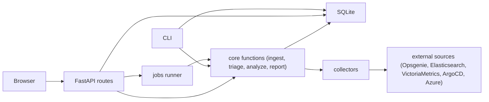

# Interface web

L'interface web est une couche fine dans le même paquet que le CLI (`aiops web`), au-dessus des mêmes fonctions Python et de la base SQLite. Elle n'apporte aucune intelligence : elle affiche, lance et suit des opérations existantes, sans dialogue direct avec Opsgenie, Elasticsearch, VictoriaMetrics, ArgoCD ou Azure.

## Principes
- Couche fine : les actions UI correspondent 1:1 aux commandes CLI ou à des écritures locales.
- Même code : `fetch`, `triage`, `analyze`, `report` sont appelés depuis le même paquet.
- Écritures locales : seul le feedback utilisateur est écrit directement par l'UI.
- Lecture seule vis-à-vis de l'infrastructure : aucune action corrective n'est exécutée.
- Suggestions : les actions du rapport sont affichées avec un bouton de copie, jamais lancées.
- Pas de build JavaScript : FastAPI, Jinja2 et htmx seulement, sans node.
- Lecture sans JS : les pages principales restent lisibles si htmx est indisponible.

## Architecture

## Écrans
1. Alertes : liste des groupes, filtres `service/env/decision/priority`, score, ajustement LLM et raison. Actions : "Récupérer les alertes" (`fetch`), "Relancer le triage" (`triage`), "Analyser" par groupe.
2. Analyse en cours : progression du job, statut par collecteur (`ok`, `timeout`, `error`), durée et erreurs. La page interroge `GET /jobs/{id}` via htmx (`hx-trigger="every 2s"`).
3. Rapport : résumé, sévérité, cause probable avec barre de confiance, timeline, puces de preuve (`alt-`, `log-`, `met-`, `dep-`, `chg-`, `hlt-`, suffixe `x` si agent) ouvrant l'élément et sa `ref` pour reproduire la requête, hypothèses, actions avec risque, runbook et bouton de copie, améliorations, bandeau des preuves manquantes. Actions : "Régénérer", formulaire de feedback (`useful`, `wrong`, `root cause was X`, commentaire).
4. Qualité des données : scorecard avec indicateur, valeur, cible, statut et tendance.
5. Historique des rapports : recherche par service/date, comparaison de deux rapports de la même alerte.

## Routes
| Méthode | Route | Équivalent CLI | Effet |
|---|---|---|---|
| GET | `/` | - | Page d'accueil |
| GET | `/alerts` | `list` | Liste des groupes et filtres |
| POST | `/fetch` | `fetch` | Démarre un job de récupération Opsgenie |
| POST | `/triage` | `triage` | Démarre un job de triage |
| POST | `/alerts/{id}/analyze` | `analyze <id>` | Démarre un job d'analyse |
| GET | `/jobs/{id}` | - | Fragment htmx avec statut du job |
| GET | `/reports` | - | Historique des rapports |
| GET | `/reports/{id}` | `report <id>` | Affiche le rapport |
| GET | `/reports/{id}/evidence/{eid}` | - | Fragment de preuve avec `ref` |
| POST | `/reports/{id}/regenerate` | `analyze <id>` puis `report <id>` | Relance l'analyse et régénère le rapport |
| POST | `/reports/{id}/feedback` | - | Écrit le feedback en base locale |
| GET | `/quality` | - | Affiche le scorecard qualité |

## Sécurité
- Bind par défaut sur `127.0.0.1`.
- En partage d'équipe, placer derrière le proxy SSO de l'entreprise (`oauth2-proxy`).
- Pas de code d'authentification dans l'application.
- Jeton CSRF sur tous les formulaires POST.
- Échappement de tout texte LLM et log via Jinja autoescape.
- Ne jamais rendre la sortie LLM comme HTML.
- Limiter `analyze` : une analyse en cours par alerte pour éviter les pics de coût LLM.

## Maquette
[maquette cliquable](mockup/index.html) avec données d'exemple, à ouvrir localement dans un navigateur.

## Hors périmètre
- Pas de websocket temps réel.
- Pas de comptes utilisateurs.
- Pas d'édition du catalogue depuis l'UI.
- Pas d'exécution des actions correctives.
