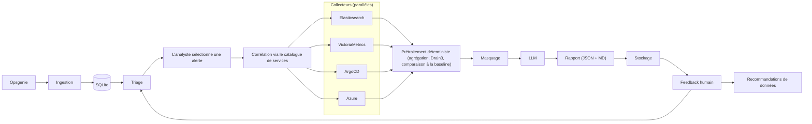
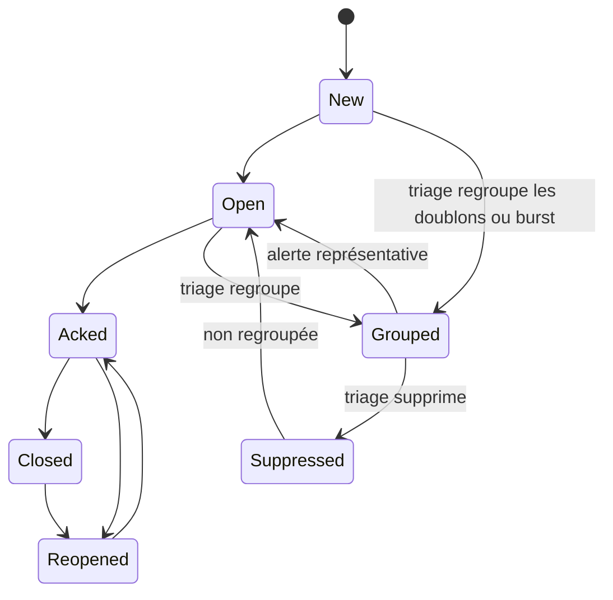
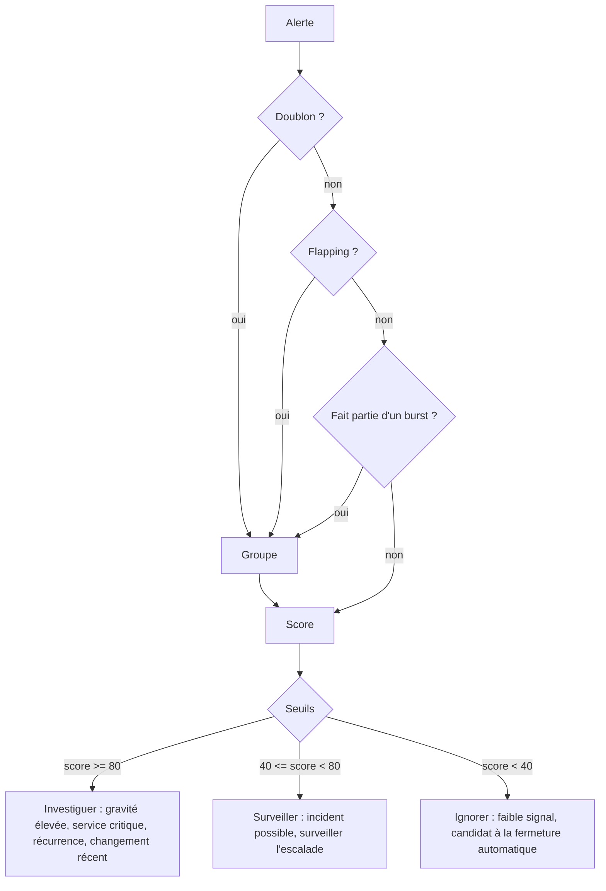
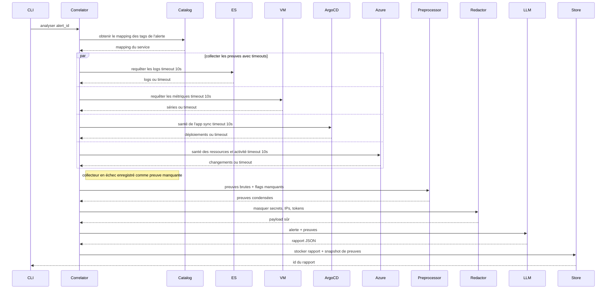
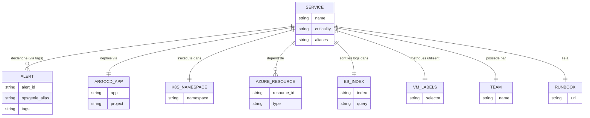
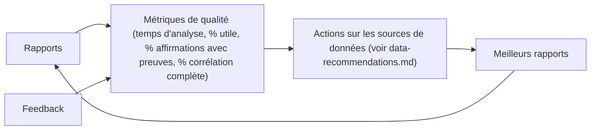

# Flux de travail

## Pipeline de bout en bout



Le pipeline est en lecture seule et centré sur les preuves. L'ingestion normalise les alertes Opsgenie dans SQLite, le triage les classe, et une alerte sélectionnée est corrélée via le catalogue de services. Les collecteurs s'exécutent en parallèle avec timeouts, le prétraitement condense les preuves de manière déterministe, le masquage supprime les valeurs sensibles, et le LLM produit un rapport structuré. Les rapports stockés et le feedback alimentent les poids de triage et les améliorations des sources de données.

## Cycle de vie des alertes



Les états du cycle de vie Opsgenie sont conservés dans la base de données locale. Le triage peut déplacer des alertes dans `Grouped` lorsqu'elles sont des doublons, flapping ou font partie d'un court burst. Les alertes Grouped peuvent être supprimées, ou une alerte représentative peut rester ouverte pour analyse. Les alertes Reopened réintègrent le flux de travail actif.

## Décision de triage



Le regroupement a lieu avant le scoring. Les doublons, les alertes flapping et les membres d'un burst sont regroupés pour qu'un incident ne soit pas scoré plusieurs fois. Le score restant combine la gravité, la criticité du service, la récurrence et les changements récents. Les seuils produisent une action et une raison lisible par un humain.

## Analyse d'une alerte



L'analyse est bornée par une fenêtre temporelle autour de l'alerte. Les quatre collecteurs s'exécutent en parallèle et de manière indépendante ; un timeout ou un échec produit des preuves partielles, pas une analyse en échec. Les collecteurs manquants sont enregistrés pour que le rapport puisse indiquer ce qui était indisponible. Le prétraitement, le masquage et le stockage sont des étapes déterministes autour de l'appel LLM.

## Modèle de corrélation



La corrélation démarre à partir des tags Opsgenie obligatoires et les résout vers un service dans `catalog/services.yaml`. L'entrée du service mappe l'app ArgoCD, le namespace Kubernetes, les IDs de ressources Azure, l'index et la requête Elasticsearch, les sélecteurs de labels VictoriaMetrics, l'équipe propriétaire et l'URL du runbook. Les mappings incomplets sont traités comme des preuves manquantes, pas devinés silencieusement.

## Boucle de feedback / amélioration



Le feedback humain est stocké avec chaque rapport. Les métriques de qualité mesurent la latence d'analyse, l'utilité, la couverture des preuves et la complétude de la corrélation. Ces métriques alimentent des actions concrètes sur les sources de données, telles que l'ajout de tags manquants, l'amélioration des entrées du catalogue, l'ajout de collecteurs ou le resserrement des requêtes. La boucle améliore les rapports futurs sans exiger une UI en v1.

## Schéma du rapport

Schéma de référence complet : [skills/incident-analysis/SKILL.md](../skills/incident-analysis/SKILL.md). Exemple simplifié :

```json
{
  "alert_id": "ops-123",
  "service": "checkout",
  "summary": "Pic de 5xx de l'API Checkout après sync ArgoCD.",
  "timeline": [
    {
      "ts": "2026-02-14T10:00:00Z",
      "event": "sync ArgoCD de checkout",
      "evidence": ["dep-1"]
    },
    {
      "ts": "2026-02-14T10:03:00Z",
      "event": "taux de 5xx au-dessus de la baseline",
      "evidence": ["met-1"]
    }
  ],
  "probable_cause": {
    "text": "Mauvais déploiement de checkout v2.3.1",
    "confidence": 0.86,
    "evidence": ["dep-1", "log-1", "met-1"]
  },
  "immediate_actions": [
    "Rollback de l'app ArgoCD checkout vers v2.3.0",
    "Scale des pods checkout à 6"
  ],
  "improvements": [
    "Ajouter une analyse canary pour checkout",
    "Ajouter une alerte sur l'échec de sync"
  ],
  "missing_evidence": [
    "azure-activity"
  ]
}
```
