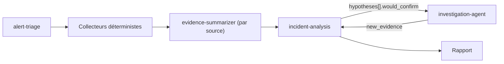

# Skills LLM

Un skill par étape du pipeline qui fait appel à un LLM. Chaque `SKILL.md` sert de prompt système (le corps, sans le frontmatter, suffit pour l'app Python). Les prompts sont en anglais pour économiser des tokens ; les textes destinés aux humains sont générés en français.

| Skill | Étape | Modèle visé | Appel |
|---|---|---|---|
| [alert-triage](alert-triage/SKILL.md) | Phase 2, après le score déterministe | petit modèle rapide | un appel par lot de groupes d'alertes |
| [evidence-summarizer](evidence-summarizer/SKILL.md) | Entre phases 3 et 4 | petit modèle / local | un appel par source |
| [incident-analysis](incident-analysis/SKILL.md) | Phase 4 | meilleur modèle disponible | un appel par alerte |
| [investigation-agent](investigation-agent/SKILL.md) | Phase 3 bis, si l'analyse a des trous | modèle avec appels d'outils | boucle d'outils, 10 appels max |

La boucle analyse → investigation → analyse tourne au plus une fois par alerte.

## Contrat commun

Élément de preuve : `{"id", "source", "ts", "kind", "text", "ref"}`. Préfixes d'id : `alt-` alerte, `log-` template de log, `met-` métrique, `dep-` déploiement ArgoCD, `chg-` changement Azure, `hlt-` santé. Les ids sont produits par le code ; l'agent d'investigation crée les siens avec un suffixe `x` (`log-x1`). Le code doit vérifier que chaque id cité existe : un id inconnu signale une hallucination et fait rejeter la sortie.

## Économiser les tokens

- Envoyer les entrées en JSON compact (sans indentation) et sans champs vides.
- Placer le skill en tête du prompt système et le garder identique d'un appel à l'autre, pour bénéficier du cache de prompt.
- Faire le gros du filtrage en code (Drain3, comparaison à la baseline, fenêtre temporelle) : le LLM ne voit que des preuves condensées.
- Valider la sortie avec un schéma JSON et renvoyer seulement l'erreur de validation en cas d'échec, pas tout le contexte.
